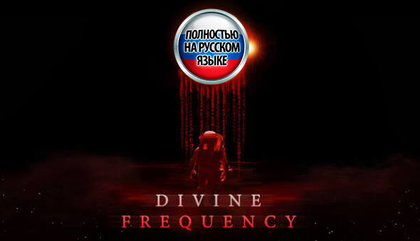
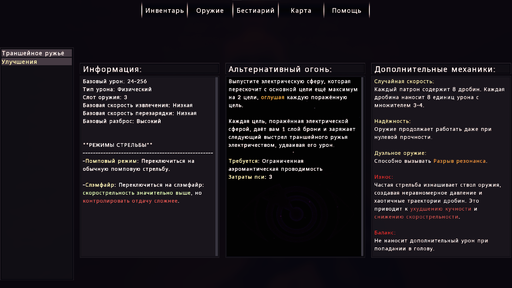

<p align="center">
  
</p>

# Divine Frequency — русский перевод

Полный русский перевод **Divine Frequency** для UZDoom: меню, интерфейс, HUD, инвентарь, кодекс, предметы, оружие, улучшения, диалоги, записки и шрифты.

Оригинальные файлы игры не изменяются. Перевод подключается одним файлом и запускается обычным ярлыком или через Steam.

**[Скачать DF_RU_Portable.zip](https://github.com/dandyhorse/Divine-Frequency-RU/releases/latest/download/DF_RU_Portable.zip)**

## Скриншоты

<p align="center">
  
</p>

<p align="center">
  
</p>

<p align="center">
  
</p>

## Что переведено

- Главное меню, выбор сложности, все настройки, загрузка и сохранение.
- HUD, инвентарь, кодекс, карта, цели и обучающие подсказки.
- Предметы, оружие, улучшения, бестиарий, записки и лор.
- NPC-диалоги, имена персонажей и инлайн-реплики из карт.
- Системные сообщения, режимы оружия, теги записок и финальные экраны.
- Шрифты с кириллицей: меню, HUD/инвентарь, диалоги и золотой шрифт имён NPC.

Озвучка остаётся английской. Часть служебных ACS-сообщений и технических терминальных логов может остаться на английском — на сюжет и интерфейс это не влияет.

## Установка

1. Скачайте и распакуйте [DF_RU_Portable.zip](https://github.com/dandyhorse/Divine-Frequency-RU/releases/latest/download/DF_RU_Portable.zip) в любую папку.
2. Запустите `install.cmd`. Установщик ищет игру в стандартных папках Steam и во всех библиотеках из `libraryfolders.vdf`.
3. Если игра не найдена автоматически, укажите папку, где лежат `DivineFrequency.exe` и `DFSDSA.ipk3`.
4. Запускайте игру обычным ярлыком или через Steam. Новый ярлык не нужен.

Патч предназначен только для **полной версии** игры. Демо-версия (`Divine Frequency Demo`) использует другие данные и не поддерживается.

Установщик копирует только один файл:

```text
<папка игры>\skins\DF_RU.wad
```

Это PK3-архив с расширением `.wad`; UZDoom автоматически загружает `.wad` из папки `skins`. Конфиг игры не изменяется.

## Удаление

Запустите `uninstall.cmd` или удалите вручную:

```text
<папка игры>\skins\DF_RU.wad
```

После удаления меню, шрифты и остальные файлы возвращаются к оригиналу.

## Сохранения

Перевод запускается обычным ярлыком и использует общую папку сохранений игры. В информации о сохранении могут быть русские названия карт и «Время:». Если открыть такой сейв в английской версии, в списке может остаться русский текст — на загрузку это не влияет.

Отдельная папка `SavesRU` не создаётся.

## Обратная связь

Если нашли опечатку, неточность или проблему с вёрсткой — создайте issue:

[GitHub Issues](https://github.com/dandyhorse/Divine-Frequency-RU/issues)

По возможности приложите скриншот и укажите, где встретилась ошибка.

## Благодарности

- Разработчикам Divine Frequency — за игру и разрешение на перевод.
- Noto Sans — за основу кириллических глифов (SIL OFL).
- Всем, кто тестировал сборку и присылал правки.

Для игры нужна лицензионная копия. Перевод не содержит игру и её ассеты — это отдельный патч.
