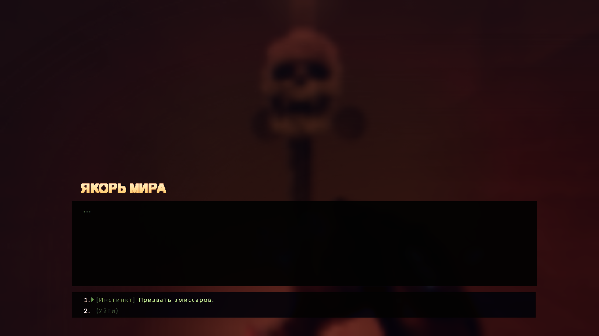
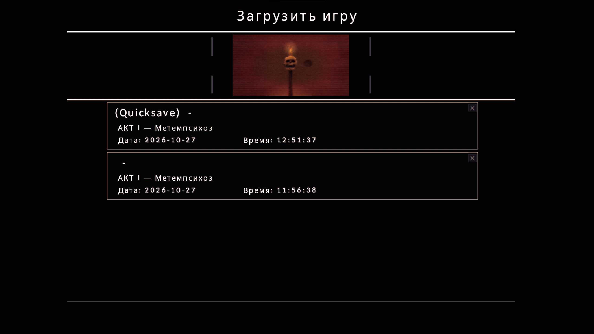

<p align="center">
  
</p>

# Divine Frequency — русский перевод

Полный русский перевод **Divine Frequency** для UZDoom: меню, интерфейс, HUD, инвентарь, кодекс, предметы, оружие, улучшения, диалоги, записки и шрифты.

Оригинальные файлы игры не изменяются. Перевод подключается одним файлом и запускается обычным ярлыком или через Steam.

**[Скачать DF_RU_Portable.zip](https://github.com/dandyhorse/Divine-Frequency-RU/releases/latest/download/DF_RU_Portable.zip)**

## Скриншоты

<p align="center">
  
</p>

<p align="center">
  
</p>

<p align="center">
  
</p>

## Что переведено

[Полная карта перевода: что было, что стало и где находится](src/TRANSLATIONS.md).

- Главное меню, выбор сложности, все настройки, загрузка и сохранение.
- HUD, инвентарь, кодекс, карта, цели и обучающие подсказки.
- Предметы, оружие, улучшения, бестиарий, записки и лор.
- NPC-диалоги, имена персонажей и инлайн-реплики из карт.
- Системные сообщения, режимы оружия, теги записок и финальные экраны.
- Сообщения скриптов карт: двери, лифты, терминалы, боссы и сюжетные подсказки.
- Шрифты с кириллицей: меню, HUD/инвентарь, диалоги и золотой шрифт имён NPC.

Озвучка остаётся английской. Намеренно повреждённые/зашифрованные технические тексты и несколько страниц без английского оригинала оставлены как в игре.

## Установка

1. Скачайте и распакуйте [DF_RU_Portable.zip](https://github.com/dandyhorse/Divine-Frequency-RU/releases/latest/download/DF_RU_Portable.zip) в любую папку.
2. Запустите `install.cmd`. Установщик ищет игру в стандартных папках Steam и во всех библиотеках из `libraryfolders.vdf`.
3. Если игра не найдена автоматически, укажите папку, где лежат `DivineFrequency.exe` и `DFSDSA.ipk3`.
4. Запускайте игру обычным ярлыком или через Steam. Новый ярлык не нужен.

Патч предназначен только для **полной версии** игры. Демо-версия (`Divine Frequency Demo`) использует другие данные и не поддерживается.

Для визуальной установки можно использовать `DF_RU_Patcher.exe`: он сам находит игру, показывает путь и умеет устанавливать, обновлять, удалять патч и запускать игру.

## Музыка установщика

В графическом установщике играет 8-bit версия **The Black Dahlia Murder — Moonlight Equilibrium**:

[YouTube](https://www.youtube.com/watch?v=WOLUFWzSd4A)

[Скачать графический установщик](https://github.com/dandyhorse/Divine-Frequency-RU/releases/latest/download/DF_RU_Patcher.exe)


Установщик копирует только один файл:

```text
<папка игры>\skins\DF_RU.wad
```

Это PK3-архив с расширением `.wad`; UZDoom автоматически загружает `.wad` из папки `skins`. Конфиг игры не изменяется.

## Удаление

Запустите `uninstall.cmd` или удалите вручную:

```text
<папка игры>\skins\DF_RU.wad
```

После удаления меню, шрифты и остальные файлы возвращаются к оригиналу.

## Сохранения

**Важно:** патч содержит переведённые ACS-сообщения и скрипты карт. Из-за этого старые сохранения, созданные без патча или в другой версии, могут не загрузиться: движок проверяет ACS-модули и данные карт. Начните новую игру; это ограничение движка, а не ошибка установки.

Перевод запускается обычным ярлыком и использует общую папку сохранений игры. В информации о сохранении могут быть русские названия карт и «Время:». Если открыть такой сейв в английской версии, в списке может остаться русский текст — на загрузку это не влияет.

Отдельная папка `SavesRU` не создаётся.

## Обратная связь

Если нашли опечатку, неточность или проблему с вёрсткой — создайте issue:

[GitHub Issues](https://github.com/dandyhorse/Divine-Frequency-RU/issues)

По возможности приложите скриншот и укажите, где встретилась ошибка.

## Благодарности

- Разработчикам Divine Frequency — за игру и разрешение на перевод.
- Noto Sans — за основу кириллических глифов (SIL OFL).
- ACC (ZDoom) — за компилятор ACS-скриптов.
- Всем, кто тестировал сборку и присылал правки.

Для игры нужна лицензионная копия. Перевод не содержит игру и её ассеты — это отдельный патч.

## Сборка из исходников

Патч собирается на Node.js. Нужны Node.js 20+, `npm install` (для генерации шрифтов используется `@napi-rs/canvas`) и установленная полная версия игры.

```bat
npm install
npm run doctor
npm run setup
npm run check
npm run apply
npm run maps
npm run build
npm run package
```

`npm run all` выполняет `apply`, `fonts`, `maps`, `build` и `package` одной командой. Если игра установлена не в `C:\Steam\steamapps\common\Divine Frequency`, путь передаётся напрямую:

```bat
node src/tools/node/cli.mjs build --ipk3 "D:\Games\Divine Frequency\DFSDSA.ipk3"
```

Структура проекта:

```text
dev/source/              локальные извлечённые тексты, в git не входят
dev/work/                локальный перевод Language.*, ZScript, ACS и карты
src/tools/node/          Node.js-сборщик, шрифты, карты, PK3 и portable-архив
src/tools/acc/           ACC и include-файлы
src/packaging/           install.cmd, uninstall.cmd, find_game.ps1, README.txt
src/TRANSLATIONS.md      полная карта EN → RU
src/imgs/                скриншоты и логотип
build/DF_RU.pk3          собранный патч (не коммитится)
build/DF_RU_Portable.zip архив для игроков (не коммитится)
```

Порядок сборки в рабочей копии:

1. `npm run setup` — скачивает `acc.exe` (ACC 1.60) в `src/tools/acc/`.
2. `npm run extract` — опционально обновляет `dev/source` из `DFSDSA.ipk3`.
3. `npm run fonts` — опционально перегенерирует кириллические PNG на Node.js + canvas; `npm run fonts -- --force` перезаписывает существующие глифы.
4. `npm run all` — применяет перевод, компилирует карты, собирает PK3 и portable-архив.

`dev/source` и `dev/work` — локальные данные рабочей копии, в публичном git они не хранятся. Скрипты рассчитаны на maintainer-сборку с этими папками.

`npm run build:legacy` собирает вариант без ACS и карт — только для совместимости со старыми сохранениями; новые сообщения карт в нём отсутствуют.

Графический установщик собирается отдельно и встраивает в себя `DF_RU.wad` и музыку:

```bat
npm run build
npm run installer
```

Результат: `build/DF_RU_Patcher.exe`. Для компиляции используется `csc.exe` из .NET Framework 4.8, отдельный .NET SDK не нужен.

Скрипты карт компилируются ACC в `BEHAVIOR` и заменяют `Maps/*.wad` внутри PK3. Поэтому portable-архив вырос примерно до 37 МБ: в нём лежат полные WAD-файлы карт с новым `BEHAVIOR`.
